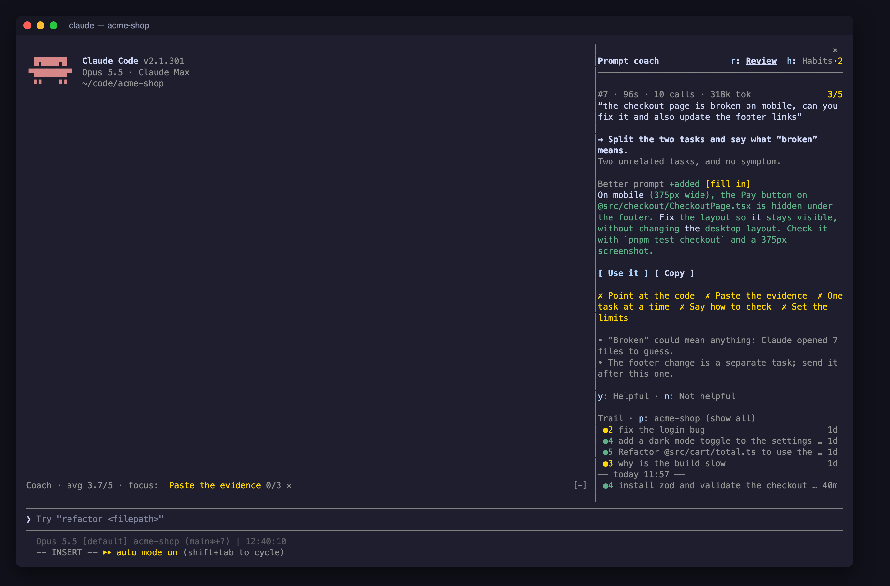
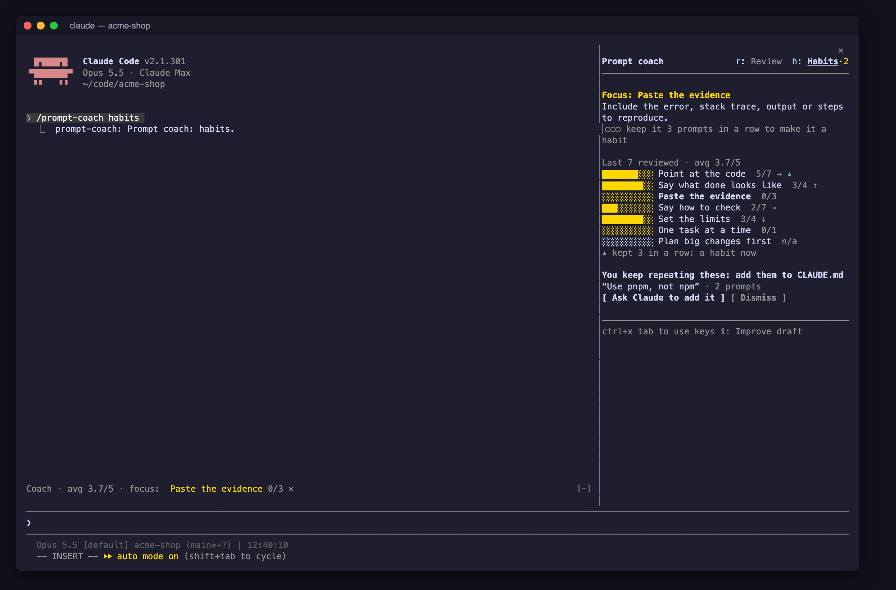
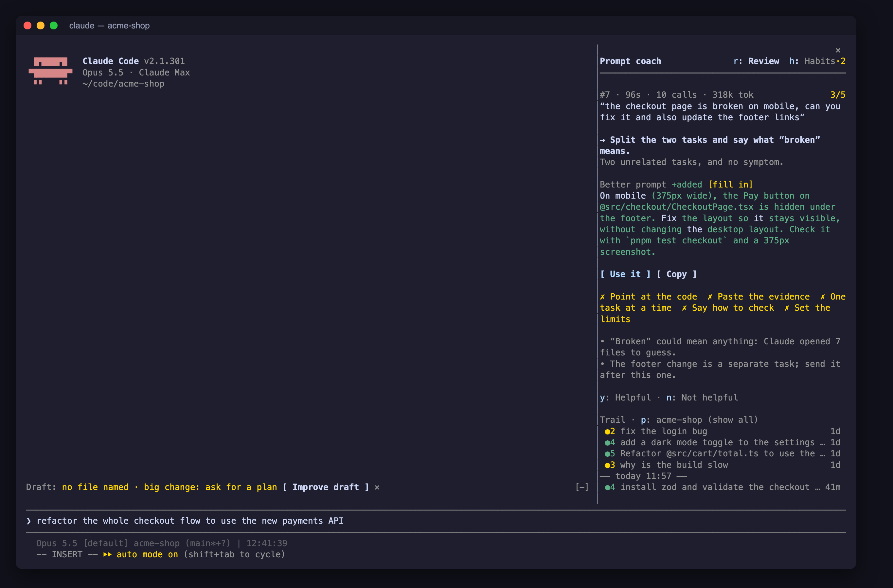

# Prompt coach

A Claude Code mod that helps you write better prompts. A sidebar keeps a trail of
your prompts and Claude's answers. After each answer it reviews the prompt you
sent, says the one change that would have helped most, and offers a better
version you can use with one key.

It has two goals:

1. **Habits.** You pick up the habits that make Claude Code work well, and keep them.
2. **Results.** Each prompt gets a better result, ideally before you send it.



The screenshots use a made-up project, `acme-shop`.

## Install

At the prompt of a Claude Code terminal session:

```
/plugin install prompt-coach --marketplace OlivierAlter/prompt-coach
```

Answer `y` to add the marketplace, then pick a scope (user scope is first; press Enter).

From a shell:

```
claude plugin install prompt-coach --marketplace OlivierAlter/prompt-coach
```

In the desktop app, where `/plugin` does not run: click **+** next to the prompt box,
then **Plugins**, then **Add marketplace** with `OlivierAlter/prompt-coach`, then **Add plugin**.

## What it does

- **Reviews each prompt** after Claude answers. The review leads with a `→ next step`,
  then a better prompt shown as a diff of yours, then the reasons. Short follow-ups
  like "yes" or "go on" are skipped, and you can still press **Review it** on one.
- **Tracks seven habits:** target, goal, evidence, verify, constraints, scope and plan.
  The **Habits** view shows your hit rate and trend for each habit, and picks one to
  focus on. Keep your focus habit for 3 prompts in a row and it graduates (★).

  
- **Improves your draft** before you send it. Missing facts become `[placeholders]`
  rather than guesses, and Undo puts your draft back.
- **Checks your draft as you type**, with no model call. It flags a draft that names
  no file, pastes no error, gives Claude no way to check its work, or asks for a big
  change without a plan.

  
- **Suggests CLAUDE.md lines.** When you give the same standing instruction twice
  ("use pnpm, not npm"), it offers to have Claude add it to CLAUDE.md.
- **Learns from your ratings.** Mark a review Helpful (`y`) or Not helpful (`n`),
  and the coach takes your recent ratings into account.

History is kept per project; press `p` to show all projects. Habits are counted
across all projects.

## Keys

When the sidebar has focus (press `ctrl+x tab` to give it the keys):

| Key | Action |
|---|---|
| `u` | Use the better prompt (fills the prompt box) |
| `c` | Copy the better prompt |
| `i` | Improve the draft in the prompt box |
| `h` / `r` | Habits view / Review view |
| `j` / `k` | Newer / older prompt |
| `v` | Review it, or Retry a slow review |
| `y` / `n` | Rate the review Helpful / Not helpful |
| `p` | This project or all projects |
| `e` | Expand a quoted prompt on a narrow sidebar |

The `/prompt-coach` command opens the sidebar. `/prompt-coach habits` opens the Habits view,
and `/prompt-coach clear` clears the history.

## Settings and cost

| Setting | Default | |
|---|---|---|
| `model` | `sonnet` | The model that reviews prompts and improves drafts: `sonnet`, `haiku` or `opus` |
| `autoReview` | `true` | Review every answered prompt. Turn it off to review only when you press **Review it** |

Each review is one model call, about half a cent with Sonnet. Improve draft costs one
call per press. The draft check as you type is free.

## Privacy

The coach sends your prompt, the end of Claude's answer, and a list of the tools
Claude used to the model you chose, through your own Claude Code session. History is
saved on your machine in Claude Code's plugin store and is sent nowhere else.

## Development

```
claude plugin validate .
claude plugin test .
claude --plugin-dir .
```

The review logic is in `hooks/coach.ts`, the hooks and sidebar are in
`hooks/register.tsx`, and the state contract is in `types/index.d.ts`. See
[ROADMAP.md](ROADMAP.md) for what has shipped and what is next.
